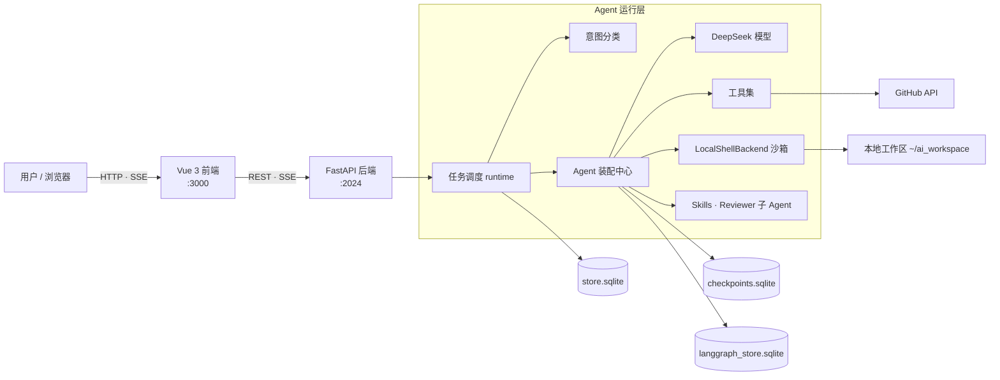

<p align="center">
  <h1 align="center">AI Coding 智能体</h1>
  <p align="center">一个运行在本地工作区、面向 GitHub 仓库的「人在回路」编码智能体</p>
  <p align="center">
    
    
    
    
    
    
  </p>
</p>

---

## 简介

AI Coding 是一个**本地化**的编码智能体（Coding Agent），在 macOS 本地工作区中运行，面向 **GitHub 仓库**工作。你只需用自然语言描述需求，智能体会先输出技术方案并**等待确认**，确认后才会真正修改代码、运行测试、提交并创建 GitHub Pull Request——改动主动权始终在你手中。

除编码外，它还支持项目分析、问答、仓库同步、工作区检查、代码审查（Reviewer 子 Agent）等**只读任务**，并提供一个基于 Vue 的 Web 交互界面。

核心能力建立在 [DeepAgents](https://github.com/langchain-ai/deepagents) + [LangGraph](https://github.com/langchain-ai/langgraph) 之上，模型使用 DeepSeek `deepseek-v4-pro`（OpenAI 兼容协议接入）。

## ✨ 核心特性

- **人在回路（Human-in-the-Loop）**：编码前「方案 → 确认 → 实施」闭环，任何写操作都经过显式授权
- **意图自动分类**：识别 `coding / analysis / planning / qa / sync / inspect / review` 七类意图，按需走只读或可写路径
- **本地沙箱执行**：虚拟路径映射 + 危险命令拦截，Agent 在受限工作区中操作真实仓库
- **GitHub 原生集成**：拉取、提交、推送、创建/复用 PR、读取 diff 与评论（REST API v3 + Bearer Token）
- **代码审查子 Agent**：内置 Reviewer 子 Agent，输出结构化 review findings
- **安全优先**：Token 经 `GIT_ASKPASS` 注入、日志与模型上下文全量脱敏、命令白名单校验
- **可观测性**：SQLite 持久化 + 日志轮转 + SSE 流式事件，前端实时呈现 Agent 的思考与工具调用
- **仓库级长期记忆**：按 `owner/repo` 隔离，跨会话复用项目上下文

## 🏗️ 架构



## 🚀 快速开始

### 环境要求

| 依赖 | 版本要求 |
| --- | --- |
| 操作系统 | macOS（仅支持 macOS） |
| Python | 3.11+（项目 `.venv` 基于 Anaconda Python 3.14 创建，**勿用系统 `python3` 3.9**） |
| Node.js | 20+（Vite 7 要求） |
| Git | 任意较新版本 |

### 安装

```bash
# 1. 创建虚拟环境并安装后端依赖
python3 -m venv .venv
.venv/bin/pip install -r requirements.txt

# 2. 配置环境变量（编辑 .env，填入 DEEPSEEK_API_KEY / GITHUB_TOKEN 等）
#    参见下方「配置」章节

# 3. 安装前端依赖
cd ui && npm install && cd ..

# 4. 启动（后端 2024 / 前端 3000）
.venv/bin/python scripts/start_all.py
```

启动后访问：

- 前端界面：<http://127.0.0.1:3000>
- 后端健康检查：<http://127.0.0.1:2024/health>

### 停止

```bash
.venv/bin/python scripts/stop_all.py
```

## ⚙️ 配置

所有配置通过 `.env` 环境变量注入。关键变量如下：

| 变量 | 默认值 | 说明 |
| --- | --- | --- |
| `DEEPSEEK_API_KEY` | — | **必填**，DeepSeek API Key |
| `DEEPSEEK_BASE_URL` | — | **必填**，DeepSeek 服务地址 |
| `MAIN_MODEL` | `deepseek-v4-pro` | 主 Agent 模型 |
| `INTENT_MODEL` | 同 `MAIN_MODEL` | 意图分类模型 |
| `INTENT_MODEL_TEMPERATURE` | `0` | 意图分类温度 |
| `INTENT_MODEL_MAX_TOKENS` | `200` | 意图分类最大 token |
| `GITHUB_TOKEN` | — | **必填**，GitHub PAT（用于建 PR / 评论，经 askpass 注入） |
| `GITHUB_API_BASE_URL` | `https://api.github.com` | GitHub API 地址 |
| `GITHUB_DEFAULT_BRANCH` | `main` | 默认分支（若为 `master` 请改这里） |
| `DEFAULT_REPO_URL` | `https://github.com/LLM-Learner1989/AI_coding` | 默认目标仓库 |
| `AI_WORKSPACE_ROOT` | `~/ai_workspace` | 工作区根目录 |
| `LOCAL_SHELL_WORKSPACE` | — | 本地 Shell 工作区（优先级高于 `AI_WORKSPACE_ROOT`） |
| `LOCAL_SHELL_PROJECTS_DIR` | `projects` | 项目子目录名 |
| `LOCAL_SHELL_ENABLE_COMMAND_GUARD` | `true` | 危险命令拦截开关 |
| `AICODING_DATA_DIR` | `./data` | SQLite 数据目录 |
| `CHECKPOINT_DB_PATH` / `STORE_DB_PATH` / `LANGGRAPH_STORE_DB_PATH` | — | 三库路径（默认落在 `data/`） |
| `AICODING_LOG_DIR` | `./logs` | 日志目录 |
| `AICODING_LOG_LEVEL` | `INFO` | 日志级别 |
| `AGENT_MAX_TOOL_CALLS` / `AGENT_MAX_SECONDS` | 按任务类型 | Agent 运行保护上限 |
| `LANGCHAIN_TRACING_V2` / `LANGSMITH_TRACING` | `false` | LangSmith 追踪开关 |

> 完整变量说明与按任务类型的运行上限见 `agent/core/middleware/run_limits.py`。

## 🔄 工作流程

以「帮我给这个仓库增加一个部门管理模块」为例：

1. **前端**：用户在界面输入需求 → 通过 SSE 发送到后端
2. **意图分类**：后端识别为 `coding` 任务
3. **人在回路**：`coding` 且无已确认方案 → 强制转为 `planning`（只读），先输出技术方案
4. **装配**：组装 DeepAgent（模型 + 工具 + 沙箱 backend + 权限 + 中间件 + skills + 持久化）
5. **确认实施**：用户确认后 → `coding` 真正改文件、测试、`git commit/push`、创建 PR
6. **收尾**：结论写回长期记忆，业务摘要更新状态与 `pr_url`，前端刷新历史

**数据边界**：聊天正文以 `checkpoints.sqlite` 为唯一权威来源；`store.sqlite` 只存业务摘要；`langgraph_store.sqlite` 只存仓库记忆。

## 🧩 任务类型

| 类型 | 说明 | 权限 |
| --- | --- | --- |
| `coding` | 修改、实现、生成代码，提交、push、建/复用 PR | 可写 |
| `planning` | 输出技术方案、实施步骤、修改建议 | 只读 |
| `analysis` | 分析项目、梳理结构、解释代码 | 只读 |
| `qa` | 概念问答、原因/区别解释 | 只读 |
| `sync` | `git pull` / 拉取、同步远程代码 | 只读 |
| `inspect` | 查看本地工作区、列出项目 | 只读 |
| `review` | 代码审查、PR review、输出审查报告 | 只读 |

> **只有 `coding` 允许写文件 / 提交 / push / 建 PR**，其余任务类型均为只读，权限在 runtime、系统提示词、`LocalShellBackend` 三层同时约束。

## 📁 项目结构

```
.
├── agent/                    # 后端（核心）
│   ├── server.py             # Agent 装配中心（get_agent）
│   ├── app.py                # FastAPI 入口
│   ├── api/                  # 健康检查 + Dashboard REST/SSE
│   ├── core/                 # 任务调度、意图分类、模型、持久化、中间件
│   ├── tools/                # GitHub / web_search / fetch / review 工具
│   ├── backends/             # LocalShellBackend 沙箱、权限、命令拦截
│   ├── store/                # 业务 SQLite Store
│   ├── skills/               # DeepAgents 技能
│   └── reviewer_rules/       # 代码审查规则
├── ui/                       # 前端（Vue 3 + Vite + Pinia）
├── scripts/                  # start_all.py / stop_all.py / 启动脚本
├── data/                     # SQLite 数据（三库）
├── logs/                     # 运行日志
├── requirements.txt          # 后端依赖
└── .env                      # 环境变量
```

## 🔐 安全设计

- **Token 安全**：GitHub Token 经 `GIT_ASKPASS`（`x-access-token` + token）注入，**绝不**写进命令、文件、commit 或 PR；所有进入日志与模型上下文的文本经 `mask_token` 脱敏
- **权限分层**：任务类型决定权限，可写能力在 runtime、系统提示词、沙箱 backend 三层同时约束
- **命令拦截**：`LocalShellBackend` 内置危险命令白名单校验与虚拟路径映射，Agent 只能操作工作区内的仓库
- **边界隔离**：文件工具使用虚拟路径 `/projects/<repo>/...`，`execute` 默认在 `projects` 目录下执行

## 🛠️ 技术栈

- **后端**：Python · FastAPI / Uvicorn · DeepAgents · LangGraph / LangChain · Pydantic · httpx
- **模型**：DeepSeek `deepseek-v4-pro`（OpenAI 兼容协议）
- **前端**：Vue 3 · Vite · Pinia · Axios · markdown-it · DOMPurify
- **存储**：SQLite（三库）+ 本地文件工作区
- **代码托管**：仅 GitHub（REST API v3）

## 📄 License

本项目为**私有（Proprietary）**项目，未开源。如需使用、分发或获取授权，请联系项目维护者。

## ⚠️ 免责声明

本工具会操作本地工作区与 GitHub 仓库，请在受控环境中使用并妥善保管 `GITHUB_TOKEN` 等凭据。使用前请确认工作区路径配置正确，避免对无关目录或生产仓库产生非预期改动。
<!-- TODO: 待补充 CI 状态徽章 -->
